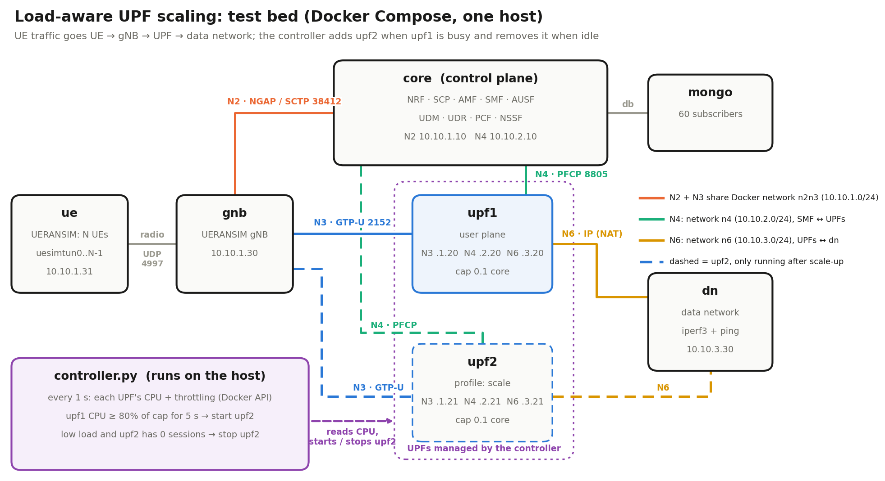
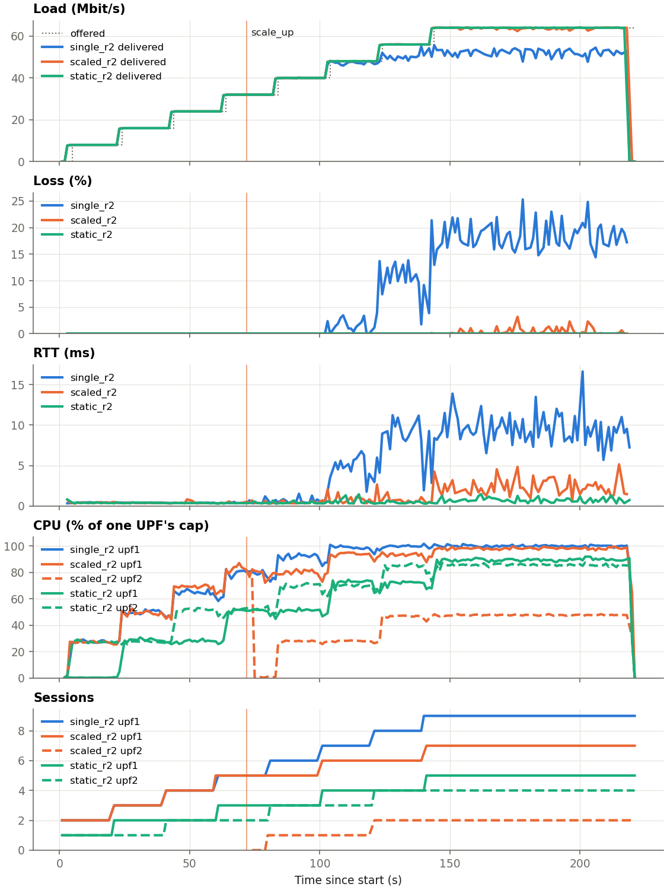
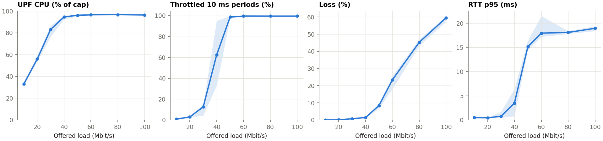

# Load-Aware UPF Scaling in a 5G Core

Open5GS 2.8.0 (core) + UERANSIM 3.2.6 (gNB, UEs) + one iperf3 data network, all in Docker Compose.
Find the load at which one UPF degrades, add a second UPF automatically when that load is reached, and show that it helps.
Design: `DESIGN.md` · full write-up (config parameters, results, limitations): **[WRITEUP.md](WRITEUP.md)**.



## Results

Measured on a 12-core Linux laptop, AC power, quiet host (load ≤ 1.6), 2026-10-19. Each UPF is capped at **0.1 core** (`UPF_QUOTA=1000`). Data is in `results/linux/`.

**One UPF vs scaling** (phase 7): 8 UEs join one every 20 s, each sending 8 Mbit/s of UDP = **64 Mbit/s**. 3 runs per set-up, fresh stack each run, 9/9 runs with no failed UEs. Mean (min–max):

| Set-up | Delivered (Mbit/s) | Loss (%) | RTT (ms) | upf1 CPU (% of cap) | UEs on upf2 |
|---|---|---|---|---|---|
| 1 UPF | 51.6 (50.7–52.1) | **19.3** (18.5–20.8) | 10.0 (9.3–11.2) | 100 | 0 of 8 |
| Controller adds upf2 (at 71–72 s) | 63.7 (63.6–63.8) | **0.5** (0.4–0.7) | 3.0 (2.4–4.1) | 99 | 2 of 8 |
| 2 UPFs from the start | 64.0 (64.0–64.0) | **0.0** | 0.7 | 85 | 4 of 8 |



**Where one UPF degrades** (phase 3): 4 UEs, 4 shuffled runs per load, 32/32 valid, medians:

| Offered (Mbit/s) | 10 | 20 | 30 | 40 | 50 | 60 | 80 | 100 |
|---|---|---|---|---|---|---|---|---|
| Delivered | 10.0 | 20.0 | 29.8 | 39.5 | 45.8 | 46.0 | 43.8 | 40.5 |
| Loss (%) | 0.0 | 0.07 | 0.7 | 1.4 | 8.4 | 23.4 | 45.3 | 59.6 |
| UPF CPU (% of cap) | 33 | 56 | 83 | 95 | 96 | 97 | 97 | 96 |
| Throttled periods (%) | 0.8 | 2.9 | 12.6 | 62.5 | 98.7 | 99.6 | 99.5 | 99.5 |
| RTT p95 (ms) | 0.49 | 0.44 | 0.77 | 3.5 | 15.2 | 18.0 | 18.1 | 19.0 |



**In short:**
- **Capacity:** one UPF carries ~46 Mbit/s, and strain starts at ~40 Mbit/s.
- **Controller:** scales up at **CPU ≥ 80% of the cap for 5 s** (~30 Mbit/s, 2/3 of the knee). It fired in 3/3 runs. It scales down only when upf2 has 0 sessions (verified).
- **UPF2 joining:** it joins with no core restart. The SMF retries the PFCP association every ~11 s, so upf2 is in use 4–6 s after it starts.
- **Session placement (phase 6):** new sessions go strictly **round-robin** (18/18 sessions in 3 traced runs), and the GTP-U traffic matched the PFCP setup for 18/18.
- **Why scaled < static:** existing sessions never move, and round-robin still sends every other new UE to the busy upf1. See [WRITEUP.md](WRITEUP.md) section 3 for all limitations.

## Requirements
Linux with Docker + Compose (final runs) or Docker Desktop (Mac, for debugging). Give Docker at least 4 CPUs / 4 GB. Python 3 with matplotlib for the plots.
Run long experiments with nothing else open (the laptop has 7 GB of RAM) and on AC power. On Linux, prefix them with `systemd-inhibit --what=sleep:idle:handle-lid-switch` so the host cannot sleep.

## Phase 1: Baseline, 1 UPF, multiple UEs

Start (about 30-55 s until all UEs are up; the first run also builds the images):
```
NUM_UES=5 docker compose up -d
```

Check:
```
docker compose logs ue | grep "TUN interface"                 # one line per UE with its IP
docker compose exec ue ping -I uesimtun0 10.10.3.30           # UE -> UPF -> data network
docker compose exec ue iperf3 -B <UE-IP> -c 10.10.3.30 -t 5   # throughput through that UE
```
`uesimtun0..N-1` are the UEs' tunnel interfaces; each is one PDU session.
After the host sleeps, UE tunnels stay up but carry nothing: `docker compose restart ue`.

More than 60 UEs: raise the default in `config/subs.js` (`60`) and the `dn` iperf3 port range (5201-5260) in `docker-compose.yml`, then `docker compose down` first so Mongo re-seeds.

Stop and wipe everything: `docker compose --profile scale down -v`

Logs: `docker compose logs core | upf1 | gnb | ue`

## What is running
| Container | IPs | Role |
|---|---|---|
| `mongo` | db net | subscriber database (keys, slice, session settings) |
| `core` | N2 10.10.1.10, N4 10.10.2.10 | control plane: NRF, SCP, UDR, UDM, AUSF, PCF, NSSF, SMF, AMF |
| `upf1` | N3 10.10.1.20, N4 10.10.2.20, N6 10.10.3.20 | user plane: forwards UE traffic |
| `upf2` | N3 10.10.1.21, N4 10.10.2.21, N6 10.10.3.21 | second UPF, `scale` profile: only runs after scale-up |
| `gnb` | 10.10.1.30 | UERANSIM base station |
| `ue` | 10.10.1.31 | UERANSIM; runs N simulated UEs |
| `dn` | N6 10.10.3.30 | data network: iperf3 server, ping target |

Networks: `n2n3` 10.10.1.0/24 (gNB, AMF, UPFs), `n4` 10.10.2.0/24 (SMF–UPFs), `n6` 10.10.3.0/24 (UPFs–DN), `db` (core–mongo).

## Conversations between the parts
| Link | Protocol / port | Carries |
|---|---|---|
| UE ↔ gNB | UDP 4997 (simulated radio) | RRC/NAS messages, and user packets |
| gNB ↔ AMF (N2) | SCTP 38412 (NGAP) | NG setup, UE registration, "set up this PDU session" |
| SMF ↔ UPF (N4) | UDP 8805 (PFCP) | association, then per-session rules (which tunnel, which UE IP) |
| gNB ↔ UPF (N3) | UDP 2152 (GTP-U) | UE packets wrapped in a tunnel, tagged with a tunnel ID (TEID) |
| UPF ↔ DN (N6) | plain IP, NAT to the UPF's N6 address | UE packets, so the DN replies to the UPF that sent them |
| NFs inside `core` | HTTP/2 on 127.0.0.x:7777 (SBI) | NF discovery (NRF/SCP), auth, subscriber data, session policy |
| UDR → mongo | MongoDB | subscriber lookups |

## Phases 2-3: Load sweep and threshold
Each step `NxR` = N UEs, each sending R Mbit/s UDP uplink:
```
docker compose down && UPF_QUOTA=1000 NUM_UES=1 docker compose up -d
python3 sweep.py results/linux/linux_threshold_q1000.csv --reps 4 --shuffle 1 4x2.5 4x5 4x7.5 4x10 4x12.5 4x15 4x20 4x25
python3 plot.py sweep results/linux/linux_threshold_q1000.csv
```
- **What each step records:** delivered throughput, loss, RTT, UPF CPU (% of its cap), % of 10 ms periods throttled, sessions, loss inside the UPF, host load and power.
- **Monitoring:** stats are read through the Docker API, never by `docker exec` into a UPF. Each such exec costs ~30 ms of CPU charged to the UPF's own budget.
- **Robustness:** it resets iperf3 between steps, uses only UEs whose tunnel really carries traffic, and restarts the UE container if tunnels die. Failed steps are retried, and every attempt is kept with a `valid` flag.
- **Cap:** use a new CSV per cap (the cap is not a column). The thresholds in `controller.py` are % of the cap: re-derive them for another `UPF_QUOTA` or host.

## Phase 4: Second UPF
`upf2` is in `docker-compose.yml` under the `scale` profile with its own N3/N4/N6 addresses (10.10.x.21). The SMF is started with both UPFs listed:
```
UPF_N4_IPS="10.10.2.20 10.10.2.21" NUM_UES=1 docker compose up -d      # only upf1 runs
docker compose --profile scale up -d --no-deps upf2                     # bring upf2 in, no SMF restart
```
The SMF retries the association with a listed but absent UPF every ~11 s, so upf2 is associated 0–11 s after it starts (3.8–5.9 s measured). New PDU sessions alternate between associated UPFs; existing sessions stay where they are.

## Phase 5: Controller
```
python3 controller.py results/controller.csv
```
- **Scale up:** when upf1's CPU is ≥ 80% of its cap (or ≥ 50% throttled while CPU ≥ 75%) for 5 s (3 s smoothing), it starts upf2 and waits for the SMF's PFCP association.
- **Scale down:** when total UPF CPU is < 35% of one cap for 20 s **and upf2 has 0 sessions**, it stops upf2. A 30 s cooldown separates actions.
- **Measured:** 3/3 scale-ups at 71–72 s under the phase 7 ramp. At idle with one UE on upf2 it waited 35 s, then stopped upf2 in the first second after that UE deregistered.

Things to know:
- UEs must leave cleanly (`./nr-cli <imsi> -e "deregister switch-off"`). A UE killed without deregistering was still counted on upf2 60 s later, so upf2 would never be retired.
- Stopping a UPF that still has sessions cuts them: the SMF notices only by missed PFCP heartbeats (10–16 s measured), releases the session, and the UE re-establishes it on the other UPF with a new IP.
- Scale-up only helps new sessions. With the existing sessions on upf1, upf2 stays idle until UEs (re)register.
- `upf.sh` `exec`s the UPF, so if the UPF exits its container stops instead of looking `Up`.

## Phase 6: Session distribution check
```
docker compose --profile scale down -v
UPF_QUOTA=1000 UPF_N4_IPS="10.10.2.20 10.10.2.21" NUM_UES=1 docker compose --profile scale up -d    # both UPFs up before the UEs
python3 session_trace.py results/linux/trace_r1 --ues 6
```
- **Captures:** PFCP on N4 (inside `core`) and GTP-U on N3 (inside `gnb`, so the UPFs pay nothing). It registers 6 new UEs and pings once through each.
- **Output:** `{n4,n3}.pcap` (open in Wireshark) and `sessions.csv`. Per new session: the UPF the SMF sent the PFCP Session Establishment to, the N3 TEID, and the UPF that UE's GTP-U packets actually reached.
- **Printed summary:** how often the UPF changed between consecutive sessions (strict round-robin = every time) and whether PFCP and GTP-U agree. `--parse dir` re-reads saved pcaps.

## Phase 7: Single vs multi-UPF comparison
`ramp.py` adds one UE every `--gap` s; each sends `--rate` Mbit/s UDP until `--hold` s after the last one, so load climbs while sessions are being placed. `compare.sh` runs three set-ups REPS times, interleaved, fresh stack each run, then prints the table (`summarize.py`):
```
OUT=results/linux/compare UPF_QUOTA=1000 sh compare.sh 3 --ues 8 --rate 8 --gap 20 --hold 60     # FIRST=2 resumes at rep 2
python3 plot.py ramp results/linux/compare/single_r2 results/linux/compare/scaled_r2 results/linux/compare/static_r2
```
- **The three set-ups:**
  - `single`: one UPF only
  - `scaled`: both UPFs listed, only upf1 running, the controller decides
  - `static`: both UPFs up from the start
- **Load:** pick `--rate` × `--ues` above the one-UPF capacity but below two UPFs' capacity (here 64 Mbit/s vs ~46 and ~92).
- **Outputs:**
  - `_timeline.csv`: per second, offered/delivered, loss, RTT, per-UPF CPU/throttling/sessions, controller actions
  - `_ues.csv`: per UE, the UPF it landed on, delivered, loss, RTT
  - `_controller.csv`: the controller's log
- **Per-second data:** throughput and loss come from the dn's per-second iperf3 server logs, so a UE that dies mid-run still contributes its seconds.

## Validity
- **Instrumentation:** stats are read from outside the UPF containers. Measured from inside with `docker exec`, each probe cost ~32 ms of CPU charged to the UPF's own budget: at 0.25 core and only 10 Mbit/s the UPF was throttled in ~23% of periods, versus 0% when read from outside. Those early runs were discarded. Every attempt is kept with a `valid` flag, load order is randomized, and power state, host load and UE restarts are logged per row.
- **Final runs:** Linux, AC, quiet host:
  - Phase 3: 4 runs per load, 32/32 valid
  - Phase 6: 3 traced runs
  - Phase 7: 3 runs per set-up, 9/9 without failed UEs
  - One phase 7 repetition was discarded and re-run after the host ran out of memory (other apps open)
- **Still limited:**
  - The 0.1-core / 10 ms quota is an artificial limit, so the absolute Mbit/s are not real UPF capacities
  - Uplink UDP only
  - One gNB, one DNN/slice, at most 2 UPFs
  - One boot of the stack per phase 3 sweep

## Phases
- [x] 1. Baseline, 1 UPF, multiple UEs
- [x] 2. Load sweep and metrics (instrumentation fixed, see Validity)
- [x] 3. Threshold (0.1 core: knee ~40 Mbit/s, capacity ~46 Mbit/s; 4 runs per load, 32/32 valid)
- [x] 4. Second UPF (starts late; the SMF retries association every ~11 s, so it is used 4-6 s after start; no SMF restart)
- [x] 5. Controller (scale-up at CPU >= 80% of cap in 3/3 runs at 71-72 s; scale-down only at 0 sessions, verified)
- [x] 6. Session distribution check (strict round-robin, PFCP and GTP-U agree on 18/18 sessions in 3 runs)
- [x] 7. Single vs multi-UPF comparison (3 runs each at 64 Mbit/s: loss 19.3% -> 0.5% scaled, 0.0% static)
- [x] 8. Write-up ([WRITEUP.md](WRITEUP.md): config parameters for multi-UPF, results, limitations)
