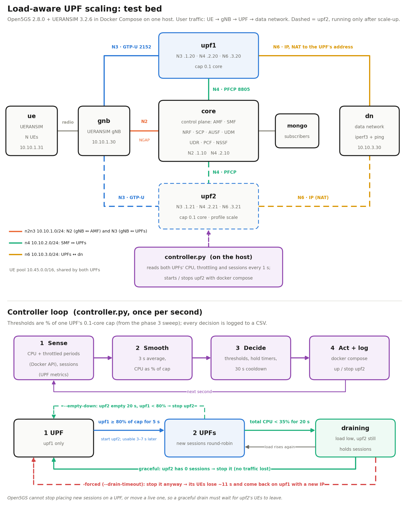
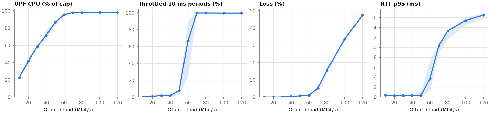
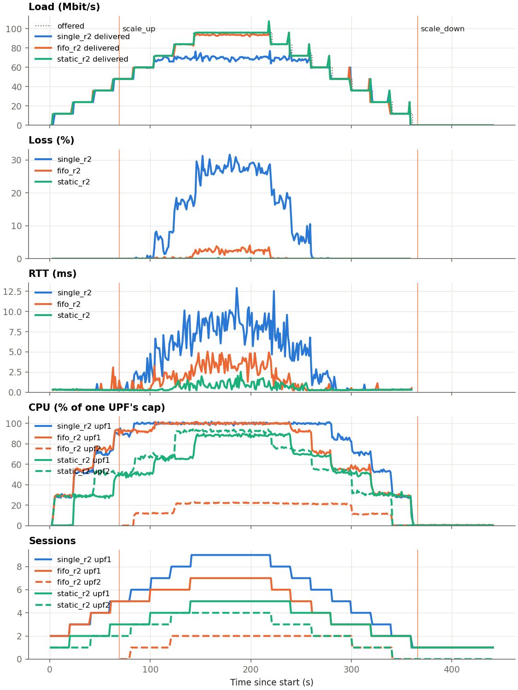
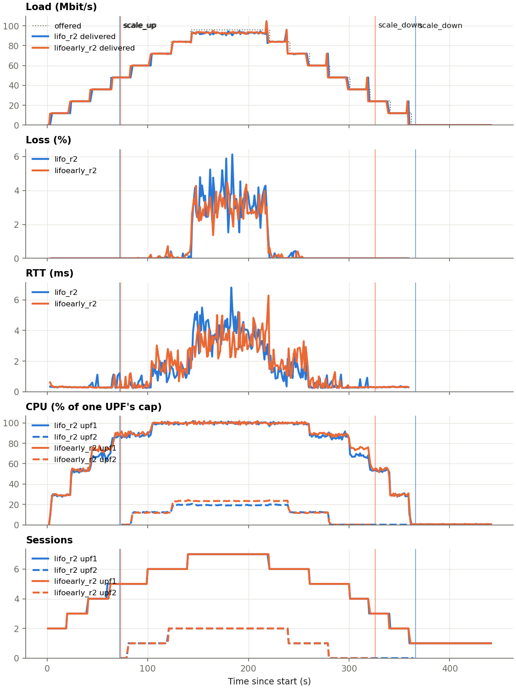
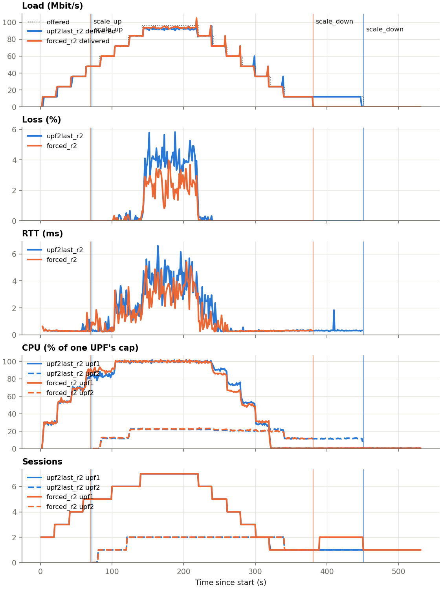

# Load-Aware UPF Scaling in a 5G Core: Write-up

Open5GS 2.8.0 core + UERANSIM 3.2.6 gNB/UEs + one iperf3 data network, in Docker Compose.
Each UPF is capped at **0.1 core** (`UPF_QUOTA=1000` over a 10 ms period) so that it, not the traffic generator, saturates first.



**Result:** one UPF at 0.1 core carries about **68 Mbit/s**, and strain starts at about **60 Mbit/s**. With 96 Mbit/s offered, adding a second UPF on demand cut loss from **27.9% to 3.9%** and RTT from **8.7 to 3.7 ms**. Starting with two UPFs gave 0.0% and 0.8 ms; the gap comes from the core's round-robin placement and from sessions never moving (section 3). Removing the second UPF again is safe when it waits for upf2 to empty (no packets lost in the 12 runs that waited; mean loss at most 0.06%), but that wait has no upper bound: one long-lived session kept upf2 running 150 s after one UPF would have been enough. Stopping upf2 as soon as it is empty saves 40 s at no cost; stopping it while it still has sessions costs those UEs ~11 s and their IP address.

The final numbers were measured in one session (`final.sh`) on one machine: a 12-core Linux laptop (HP Pavilion Gaming 15) on AC power, CPU governor `performance`, nothing else running (host load 0.3), on 2026-11-10. Raw data is in `results/final/`, all tables in `results/final/summary.md`. An earlier calibration (2026-10-19, `results/linux/`) is compared at the end of the phase 3 section.

## Results

### Phase 3: where one UPF degrades (`results/final/threshold.csv`)

4 UEs, offered load 10–120 Mbit/s, 4 shuffled repetitions per load. 40/40 runs were valid (no failed iperf3, no dead tunnels, no UE restarts). Medians:

| Offered (Mbit/s) | 10 | 20 | 30 | 40 | 50 | 60 | 70 | 80 | 100 | 120 |
|---|---|---|---|---|---|---|---|---|---|---|
| Delivered (Mbit/s) | 10.0 | 20.0 | 30.0 | 39.8 | 49.7 | 59.4 | 66.4 | 67.7 | 66.5 | 63.2 |
| Loss (%) | 0.0 | 0.0 | 0.02 | 0.4 | 0.7 | 1.0 | 5.1 | 15.4 | 33.5 | 47.3 |
| UPF CPU (% of cap) | 23 | 42 | 58 | 71 | 87 | 95 | 98 | 98 | 98 | 98 |
| Throttled 10 ms periods (%) | 0.3 | 0.9 | 1.7 | 1.5 | 7.6 | 66.7 | 99.7 | 99.7 | 99.6 | 99.6 |
| RTT p95 (ms) | 0.33 | 0.31 | 0.30 | 0.29 | 0.29 | 3.7 | 10.4 | 13.3 | 15.4 | 16.5 |



- **Capacity:** delivered throughput flattens at about 68 Mbit/s; past it extra load only adds loss (47% at 120 offered).
- **Knee:** at 60 Mbit/s throttling jumps to 67% of periods and the RTT tail to 3.7 ms; from 70 Mbit/s the UPF is throttled in nearly every period.
- **Threshold:** the controller scales up at **CPU ≥ 80% of the cap** (or ≥ 50% throttled while CPU ≥ 75%), held for 5 s. Here that is ~45 Mbit/s (71% at 40, 87% at 50), about 3/4 of the knee (2/3 of the capacity), because a scale-up takes 5 s plus 3–7 s for the association and only helps sessions placed afterwards. 30 Mbit/s (58% CPU) never triggers it.
- **Cap, not host speed:** the cap is CPU time (1 ms per 10 ms), so how many Mbit/s fit in it depends on the CPU.

**Earlier calibration, same cap, slower CPU setting** (2026-10-19, `results/linux/linux_threshold_q1000.csv`, 32/32 valid): capacity ~46 Mbit/s, knee ~40 Mbit/s, 80% of the cap reached at ~30 Mbit/s. The Mbit/s moved by ~1.5x between the two host settings, but **the same % thresholds** landed at about 3/4 of the knee both times, and the phase 7 comparison gave the same picture (1 UPF 19.3% loss, controller 0.5%, 2 UPFs 0.0% at 64 Mbit/s). This is why the thresholds are kept as % of the cap, and why all final numbers come from one session.

### Phases 4–5: second UPF and controller

| Check | Result |
|---|---|
| UPF2 joins with no SMF restart | The SMF retries the PFCP association with a listed but absent UPF about every 11 s. UPF2 started at 14:14:17.9 and was associated at 14:14:21.7 (3.8 s) |
| Scale-up under load (15 runs) | Fired at 69–73 s, after the 4th UE joined (48 Mbit/s, upf1 CPU crossing 80%). UPF2 associated 3.3–6.5 s after the controller acted |
| No false scale-up at idle | 35 s idle with both UPFs at < 1% CPU: no scale-up (`results/linux/scale_down_controller.csv`) |
| No flapping | No scale-up during any of the 15 ramp-downs, and no scale-down while load was high |
| Scale-down only at 0 sessions | 12/12 scale-downs that waited happened with upf2 at 0 sessions, with no packet loss during the ramp-down (mean at most 0.06%); the other 3 runs were forced stops (phase 8) |
| UPF crash visible | `upf.sh` `exec`s the UPF, so when the UPF exits the container shows `Exited` instead of staying `Up` (tested with SIGTERM) |

### Phase 6: how new sessions are distributed (`results/linux/trace_r{1,2,3}/`)

PFCP was captured on N4 inside `core` and GTP-U on N3 inside `gnb`, so the UPFs pay nothing for the capture. Both UPFs were up, and 6 new UEs were added per run, 3 runs:

| Run | UPF chosen by the SMF (PFCP Session Establishment), in order | GTP-U reached that UPF with that TEID |
|---|---|---|
| 1 | upf2, upf1, upf2, upf1, upf2, upf1 | 6/6 |
| 2 | upf2, upf1, upf2, upf1, upf2, upf1 | 6/6 |
| 3 | upf2, upf1, upf2, upf1, upf2, upf1 | 6/6 |

That is **strict round-robin in 18/18 sessions**, regardless of load. Each run starts at upf2 because the one UE registered at startup took upf1. The pcaps (`n4.pcap`, `n3.pcap`) open in Wireshark.

### Phase 7: one UPF vs scaling vs two UPFs (`results/final/ramp/`)

The ramp adds one UE every 20 s, each sending 12 Mbit/s of UDP uplink, up to 8 UEs = **96 Mbit/s**: about 1.4x one UPF's capacity, within two UPFs' capacity (`final.sh` picks the rate from the phase 3 knee). Each run used a fresh stack, 3 repetitions per set-up, interleaved with the phase 8 variants; 0 failed UEs or radio link failures. Values are the steady state (10 s after the last UE joined until the first leaves), mean (min–max):

| Set-up | Delivered (Mbit/s) | Loss (%) | RTT (ms) | upf1 CPU (% of cap) | UEs on upf2 | Scale-up at |
|---|---|---|---|---|---|---|
| 1 UPF | 69.3 (68.8–69.6) | 27.9 (27.5–28.3) | 8.7 (8.4–9.1) | 100 | 0 of 8 | — |
| Controller adds upf2 | 92.3 (91.2–93.6) | 3.9 (2.5–5.0) | 3.7 (3.5–4.1) | 100 | 2 of 8 | 69–70 s |
| 2 UPFs from the start | 96.0 (96.0–96.0) | 0.0 | 0.8 (0.7–1.0) | 90 | 4 of 8 | — |



With one UPF, delivered traffic stops at about 69 Mbit/s once the 6th UE joins (72 Mbit/s offered). With the controller, upf2 is added after the 4th UE and UEs 5 and 7 land on it (0.0% loss). UEs 6 and 8 still go to upf1 by round-robin, so upf1 carries 6 UEs = 72 Mbit/s, just over its capacity, and its UEs see ~2% loss over the run (3.9% in the full-load steady state). With two UPFs from the start, each carries 4 UEs at ~90% of its cap with no loss.

### Phase 8: scale-down (`results/final/ramp/`)

Same runs as phase 7, continued: after the 60 s hold at full load, one UE stops its traffic and deregisters cleanly (`nr-cli … deregister switch-off`) every 20 s, then 60 s with no UEs. UEs 5 and 7 are on upf2 in every run. Five variants, 3 runs each, mean (min–max). "Fits on one" means offered load below 45 Mbit/s (≤ 3 UEs, from 301 s), where upf1 alone stays under the 80% scale-up limit:

| Variant | Order UEs leave | Controller | upf2 empty at | upf2 stopped at | upf2 running while empty | 2 UPFs after load fits on one | Lost |
|---|---|---|---|---|---|---|---|
| fifo | 1, 2, … 8 | default | 340 s | 365 s (365–366) | 25 s | 64 s (64–65) | nothing |
| lifo | 8, 7, … 1 | default | 280 s | 366 s (365–366) | **86 s** (85–86) | 65 s (64–65) | nothing |
| lifoearly | 8, 7, … 1 | `--empty-down` | 280 s | **326 s** (325–326) | 45 s (44–46) | **25 s** (24–25) | nothing |
| upf2last | upf1's UEs, then 5, then 7 after 90 s more | default | 450 s | 451 s (450–451) | 0 s | **150 s** (149–150) | nothing |
| forced | as upf2last | `--drain-timeout 30` | — | 381 s (380–381) | 0 s | 80 s (79–80) | **UE 7: 10.7 s (10–12), new IP** |




- **Two conditions set the timing.** The default rule needs total CPU < 35% of one cap for 20 s (in practice ≤ 2 UEs, from ~321 s) **and** upf2 at 0 sessions. In fifo the sessions are the last condition to be met, in lifo the CPU one. Both end at ~365 s.
- **An empty upf2 is waste, not safety.** In lifo, upf2 ran 86 s with no sessions while upf1 carried everything. `--empty-down` stops it once it has been empty for 20 s and upf1 alone is under the 80% limit: 40 s sooner, with no loss, because an empty UPF carries no traffic. It still waits while upf1 is busy, so a new UE arriving then still gets upf2.
- **A graceful drain has no upper bound.** In upf2last, one UE (12 Mbit/s) kept upf2 alive for 150 s after one UPF would have been enough, and would have kept it forever if it never left.
- **Forcing bounds it, at a price.** With `--drain-timeout 30`, upf2 was stopped 30 s after the low-load condition held. The SMF noticed only by missed PFCP heartbeats, released the session, and the UE re-established it on upf1 with a **new IP**: 10.7 s (10–12) without traffic, matching the 10–16 s measured earlier. Its old connection (iperf3 bound to the old IP) did not recover; a real application would have to reconnect.
- **Nothing else was disturbed:** No packet loss in the 12 runs that waited for 0 sessions (mean at most 0.06%), and no scale-up was triggered while UEs were leaving.

## 1. Core configuration needed for two UPFs

Adding a UPF in Open5GS needs changes in three places: the SMF's UPF list, the new UPF's own addresses, and the network around it. The SMF is never restarted to add a UPF. It is configured with both from the start, and upf2 joins at runtime by PFCP association.

| Where | Parameter | Value here | Why it is needed |
|---|---|---|---|
| `smf.yaml` | `smf.pfcp.client.upf[].address` | `10.10.2.20`, `10.10.2.21` (`UPF_N4_IPS`) | Every UPF the SMF may use must be listed. The SMF keeps trying to associate with a listed UPF that is down; once it answers, it is used within ~3 s, without an SMF restart |
| `smf.yaml` | `smf.pfcp.server.address` | `10.10.2.10` (N4) | The address the UPFs' PFCP association and heartbeats come back to |
| `smf.yaml` | `smf.session[].subnet` / `gateway` / `dnn` | `10.45.0.0/16`, `10.45.0.1`, `internet` | The SMF hands out UE IPs from this pool for **both** UPFs. Open5GS cannot tie a pool to one UPF in this setup |
| `smf.yaml` (optional) | `upf[].dnn` / `tac` / `nr_cell_id` | not set | Pins sessions to a UPF by DNN, TAC or cell. With none set, the SMF alternates between associated UPFs (verified in phase 6) |
| `upf.yaml` (each UPF) | `upf.pfcp.server.address` | `10.10.2.2x` (N4) | Must equal the address listed in the SMF |
| `upf.yaml` (each UPF) | `upf.gtpu.server.address` | `10.10.1.2x` (N3) | Sent to the gNB in the PDU session setup; the gNB tunnels uplink to it |
| `upf.yaml` (each UPF) | `upf.session[].subnet` + `ogstun` | `10.45.0.0/16`, `10.45.0.1/16` | Each UPF must route the whole UE pool into its TUN device for downlink |
| `upf.sh` (each UPF) | `iptables … MASQUERADE` on N6 | `-s 10.45.0.0/16 -o <N6 dev>` | Both UPFs serve the same pool, so the DN could not tell which UPF owns a UE address. NAT makes replies go back to the UPF that sent them. Without NAT, each UPF needs its own pool plus per-UPF routes on N6 |
| `docker-compose.yml` | `upf2` own N3/N4/N6 IPs, `profiles: [scale]` | `10.10.{1,2,3}.21` | Separate interfaces per UPF (task 4); the profile keeps upf2 off until the controller starts it |
| `docker-compose.yml` | `cpu_quota` / `cpu_period` | `1000` / `10000` | The artificial 0.1-core cap that makes a UPF saturate at a load UERANSIM can generate |
| `amf.yaml`, `gnb.yaml` | nothing UPF-specific | | The gNB learns each session's UPF N3 address from the AMF/SMF; no RAN change is needed |

## 2. How the scaling works

1. `controller.py` reads each running UPF's CPU (share of its cap) and throttled periods every second, smoothed over 3 s, through the Docker API (never `docker exec` into a UPF, which would spend the UPF's own budget).
2. **Scale up:** when upf1 stays over the threshold for 5 s, it starts the `upf2` container. The SMF already lists upf2, so it associates over PFCP and starts placing **new** sessions on it.
3. **Scale down:** when the total UPF CPU stays below 35% of one cap for 20 s **and upf2 has 0 sessions** (read from its metrics endpoint), it stops upf2. Two thresholds, a hold time and a 30 s cooldown prevent flapping.
4. **Options** (phase 8): `--empty-down` also stops upf2 once it has been empty for 20 s while upf1 alone is under the 80% limit; `--drain-timeout S` stops upf2 even with sessions S s after the low-load condition held, cutting them.

See the lower half of the architecture figure for the loop and the 1 UPF → 2 UPFs → draining → 1 UPF cycle.

## 3. Practical limitations of dynamic UPF scaling in Open5GS

| # | Limitation | Evidence | Consequence |
|---|---|---|---|
| 1 | **UPF selection is round-robin, not load-aware.** The only selectors are static (DNN, TAC, cell ID) | Phase 6: 18/18 sessions alternate. Phase 7: after scale-up, every other new UE still goes to the saturated upf1 | Scaling helps only half of the new sessions. A load-aware SMF, or a selector the controller could change, would put all of them on upf2 |
| 2 | **Existing sessions never move** | Phase 7: the 4 UEs placed before scale-up stay on upf1 to the end | Scaling relieves only *future* load. Hence scaled (3.9% loss) vs static (0.0%) |
| 3 | **No graceful drain.** The SMF cannot be told to stop picking a UPF, and a UE that dies without deregistering leaves its session behind | Phase 6: the SMF keeps selecting upf2 while it is associated. Phase 8: one long-lived session kept upf2 running 150 s after the load fit on one UPF. A UE killed without deregistering was still counted on upf2 after 60 s | Scale-down waits until upf2's sessions end, for an unbounded time. UEs must deregister cleanly, or upf2 is never retired |
| 4 | **Stopping a UPF that has sessions cuts them** | upf2 stopped with a live UE on it: the SMF noticed only by missed PFCP heartbeats (10 s and 16 s in two early runs). It released the session, and the UE re-established it on upf1 with a **new IP**. Phase 8, `--drain-timeout`: 10.7 s (10–12) without traffic in 3/3 runs | Such a UE loses ~11 s of traffic and its address. By default the controller stops upf2 only at 0 sessions; `--drain-timeout` trades that outage for a bounded drain |
| 5 | **Scale-up takes 5 s plus 0–11 s** | Hold 5 s; the SMF retries the association every ~11 s. Measured 3.3–6.5 s after the controller acted (15 runs) | Thresholds must sit well below the knee (here about 3/4), or the burst is over before upf2 helps |
| 6 | **Shared UE pool needs NAT on N6** | Section 1 | The DN sees the UPF's address, not the UE's. Per-UE identity is only visible on N3 (inner IP in GTP-U) |
| 7 | **Mbit/s per cap depend on the host** | The cap is CPU time: 0.1 core carried ~46 Mbit/s on 2026-10-19 and ~68 Mbit/s on 2026-11-10 on the same laptop (different CPU setting). The same % thresholds still triggered at about 3/4 of the knee both times | Re-run phase 3 per host and per `UPF_QUOTA`. Keep the thresholds as % of the cap, and take all reported numbers from one session |
| 8 | **Per-second signals are noisy** | Throttled periods swing ±10–15 points second to second at a steady load | The controller smooths over 3 s and requires 5 s above the threshold |
| 9 | **The test bed limits what can be shown** | 0.1-core cap is artificial; UERANSIM tops out ~200 Mbit/s; uplink UDP only; one gNB, one DNN/slice, at most 2 UPFs | Absolute Mbit/s figures are not real UPF capacities. The *shape* (knee, relief, round-robin effect) is the result |
| 10 | **The host must be quiet** | A repetition was discarded after VS Code + Chrome filled RAM/swap (load 88, OOM kills) | Run final measurements with nothing else open. `sweep.py` logs host load and power per row; `final.sh` records the host state |
| 11 | **Scale-down is all-or-nothing per UPF** | Phase 8: the controller can only stop a whole UPF; it cannot move upf2's last UE to upf1 first | Either wait (graceful, unbounded) or cut (forced, ~11 s outage). A core that can relocate sessions, or steer new ones away from a draining UPF, would avoid both |

## 4. Reproduce

Everything in sections "Results" except phases 4–6 comes from one script (~3.5 h). Run it with nothing else open and detached from the terminal:
```bash
mkdir -p results/final
nohup systemd-inhibit --what=sleep:idle:handle-lid-switch sh final.sh > results/final/final.log 2>&1 &
tail -5 results/final/progress.log      # progress; the tables land in results/final/summary.md
```
It writes the host state, runs the phase 3 sweep (`sweep.py`), picks the per-UE rate from the knee, then runs 3 interleaved repetitions of `single`, `static`, `fifo`, `lifo`, `upf2last`, `forced`, `lifoearly` (`ramp.py` with ramp-up and ramp-down, controller where needed), and summarises (`summarize.py`) and plots (`plot.py`). Resume with `SKIP_SWEEP=1 FIRST=2 sh final.sh`. Plot with `PYTHONNOUSERSITE=1` if a user-installed NumPy 2 breaks the system matplotlib.

Phase 6 (≈1 min per run, both UPFs up before any UE):
```bash
docker compose --profile scale down -v
UPF_QUOTA=1000 UPF_N4_IPS="10.10.2.20 10.10.2.21" NUM_UES=1 docker compose --profile scale up -d
python3 session_trace.py results/linux/trace_r1 --ues 6
```
